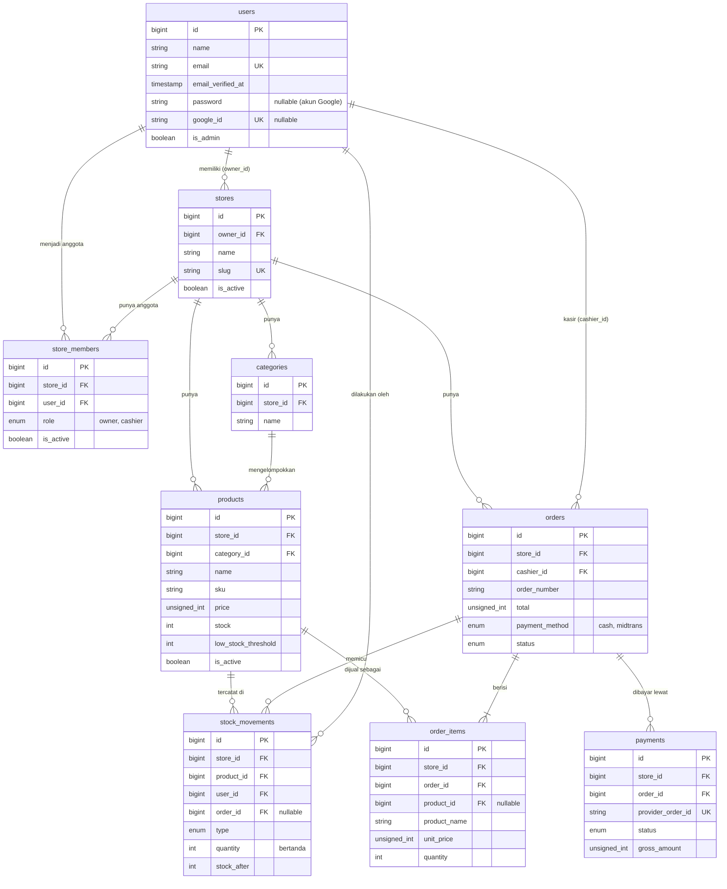

# ERD: CuanBozz

Skema database untuk CuanBozz (MySQL). Diagram di bawah memakai Mermaid, jadi otomatis tampil di GitHub.

## Prinsip desain

1. **Multi-tenant satu database**: semua tabel bisnis punya `store_id`. Model memakai trait `BelongsToStore` (global scope) sehingga query otomatis difilter per toko.
2. **Uang = integer rupiah**: semua kolom uang bertipe `unsignedBigInteger`, tanpa desimal.
3. **Snapshot**: `order_items` menyimpan nama dan harga produk saat transaksi, sehingga riwayat tidak berubah saat produk diubah.
4. **Stok = ledger**: setiap perubahan stok tercatat di `stock_movements`; `products.stock` adalah nilai saat ini.
5. **Soft state, bukan hapus**: toko, anggota, dan produk dinonaktifkan lewat `is_active`; order tidak pernah dihapus, hanya diberi status `cancelled`.

## Diagram

## Definisi tabel

Kolom `created_at` dan `updated_at` ada di semua tabel kecuali dicatat lain.

### users

| Kolom | Tipe | Catatan |
|---|---|---|
| id | bigint PK | |
| name | string | |
| email | string, unique | |
| email_verified_at | timestamp, nullable | Otomatis terisi untuk akun Google |
| password | string, nullable | Kosong untuk akun yang hanya memakai Google |
| google_id | string, nullable, unique | Dari Socialite |
| avatar | string, nullable | URL foto dari Google |
| is_admin | boolean, default false | Admin platform |
| remember_token | string, nullable | |

### stores

| Kolom | Tipe | Catatan |
|---|---|---|
| id | bigint PK | |
| owner_id | FK users | Pemilik toko |
| name | string | |
| slug | string, unique | |
| address | text, nullable | |
| phone | string, nullable | |
| logo_path | string, nullable | |
| is_active | boolean, default true | Dinonaktifkan oleh admin platform |

### store_members

Menghubungkan user dengan toko beserta perannya. Pemilik juga dicatat di sini dengan role `owner`.

| Kolom | Tipe | Catatan |
|---|---|---|
| id | bigint PK | |
| store_id | FK stores | |
| user_id | FK users | |
| role | enum(`owner`, `cashier`) | |
| is_active | boolean, default true | |

Unique: (`store_id`, `user_id`). Pada versi 1, satu user hanya boleh punya satu keanggotaan aktif.

### categories

| Kolom | Tipe | Catatan |
|---|---|---|
| id | bigint PK | |
| store_id | FK stores | |
| name | string | |

Unique: (`store_id`, `name`).

### products

| Kolom | Tipe | Catatan |
|---|---|---|
| id | bigint PK | |
| store_id | FK stores | |
| category_id | FK categories, nullable | Null jika kategori dihapus |
| name | string | |
| sku | string, nullable | |
| barcode | string, nullable | |
| price | unsigned int | Rupiah |
| stock | int, default 0 | Tidak boleh negatif |
| low_stock_threshold | int, default 0 | Batas peringatan stok menipis |
| photo_path | string, nullable | |
| is_active | boolean, default true | |

Unique: (`store_id`, `sku`) bila `sku` terisi. Index: (`store_id`, `name`), (`store_id`, `barcode`).

### stock_movements

Ledger perubahan stok. Baris tidak pernah diubah atau dihapus. Hanya punya `created_at`.

| Kolom | Tipe | Catatan |
|---|---|---|
| id | bigint PK | |
| store_id | FK stores | |
| product_id | FK products | |
| user_id | FK users | Pelaku perubahan |
| order_id | FK orders, nullable | Terisi bila dipicu transaksi |
| type | enum(`initial`, `sale`, `cancel_return`, `adjustment`) | |
| quantity | int | Bertanda: negatif untuk pengurangan |
| stock_after | int | Stok setelah perubahan |
| reason | string, nullable | Wajib untuk `adjustment` |

Index: (`store_id`, `product_id`, `created_at`).

### orders

| Kolom | Tipe | Catatan |
|---|---|---|
| id | bigint PK | |
| store_id | FK stores | |
| cashier_id | FK users | Kasir yang membuat order |
| order_number | string | Contoh `INV-20261018-0001` |
| subtotal | unsigned int | Sebelum diskon |
| discount_type | enum(`amount`, `percent`), nullable | |
| discount_value | unsigned int, default 0 | Nilai input (nominal atau persen) |
| discount_amount | unsigned int, default 0 | Hasil hitung dalam rupiah |
| total | unsigned int | `subtotal - discount_amount` |
| payment_method | enum(`cash`, `midtrans`) | |
| status | enum(`pending`, `paid`, `expired`, `failed`, `cancelled`) | |
| cash_received | unsigned int, nullable | Untuk pembayaran tunai |
| change_amount | unsigned int, nullable | Kembalian |
| receipt_token | string, unique | Token acak untuk tautan struk |
| paid_at | timestamp, nullable | |
| cancelled_at | timestamp, nullable | |
| cancelled_by | FK users, nullable | |
| cancel_reason | string, nullable | |

Unique: (`store_id`, `order_number`). Index: (`store_id`, `status`, `created_at`), (`store_id`, `cashier_id`, `created_at`).

Transisi status yang valid:

| Dari | Ke |
|---|---|
| pending | paid, expired, failed, cancelled |
| paid | cancelled (hanya pemilik) |
| expired, failed, cancelled | (final) |

Order tunai langsung dibuat dengan status `paid`.

### order_items

| Kolom | Tipe | Catatan |
|---|---|---|
| id | bigint PK | |
| store_id | FK stores | |
| order_id | FK orders | |
| product_id | FK products, nullable | `nullOnDelete`, referensi saja |
| product_name | string | Snapshot |
| unit_price | unsigned int | Snapshot |
| quantity | unsigned int | Minimal 1 |
| line_total | unsigned int | `unit_price * quantity` |

Tabel ini tidak memakai `updated_at`.

### payments

Satu order nontunai punya satu atau lebih percobaan pembayaran.

| Kolom | Tipe | Catatan |
|---|---|---|
| id | bigint PK | |
| store_id | FK stores | |
| order_id | FK orders | |
| provider | string, default `midtrans` | |
| provider_order_id | string, unique | `order_id` yang dikirim ke Midtrans |
| transaction_id | string, nullable | Dari notifikasi Midtrans |
| payment_type | string, nullable | `qris`, `gopay`, `bank_transfer`, dst. |
| gross_amount | unsigned int | Harus sama dengan `orders.total` |
| status | enum(`pending`, `paid`, `expired`, `failed`) | |
| snap_token | string, nullable | |
| expires_at | timestamp, nullable | 15 menit sejak dibuat |
| paid_at | timestamp, nullable | |
| raw_payload | json, nullable | Notifikasi terakhir, untuk audit |

## Aturan integritas

- Foreign key ke `stores` memakai `restrictOnDelete`; toko dinonaktifkan, tidak dihapus.
- `products.stock` tidak boleh negatif: dijaga di kode (`lockForUpdate`) dan, bila MySQL mendukung, constraint `CHECK (stock >= 0)`.
- `payments.gross_amount` harus sama dengan `orders.total`; webhook dengan jumlah berbeda ditolak.
- Webhook idempoten: jika `payments.status` sudah `paid`, notifikasi berikutnya diabaikan tanpa efek samping.
- Setiap query pada tabel bisnis wajib melalui scope `store_id`. Test lintas toko adalah syarat wajib (lihat `AGENTS.md`).
