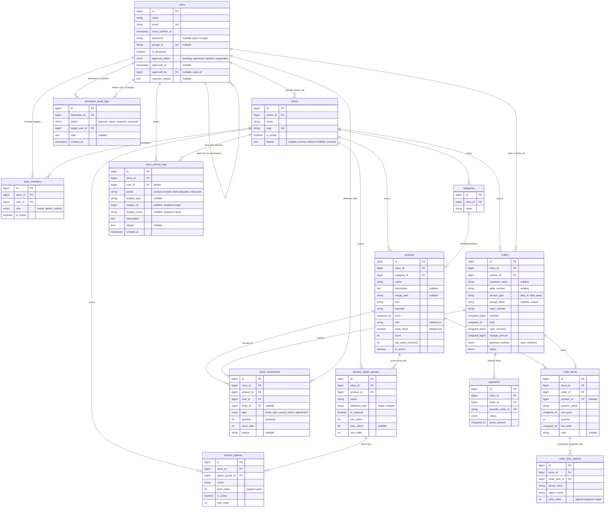

# ERD: CuanBozz

Skema database untuk CuanBozz (MySQL). Diagram di bawah memakai Mermaid, jadi otomatis tampil di GitHub.

## Prinsip desain

1. **Multi-tenant satu database**: semua tabel bisnis punya `store_id`. Model memakai trait `BelongsToStore` (global scope) sehingga query otomatis difilter per toko.
2. **Uang = integer rupiah**: nilai uang tidak memakai desimal/float. Harga dan total non-negatif disimpan sebagai integer unsigned; `price_delta` disimpan sebagai integer bertanda.
3. **Snapshot**: `order_items` menyimpan nama, harga satuan final, catatan, dan snapshot nama grup/opsi serta selisih harganya saat transaksi.
4. **Stok = ledger**: setiap perubahan stok produk yang dilacak tercatat di `stock_movements`; `products.stock` adalah nilai saat ini. Produk dengan `track_stock=false` tidak memakai ledger.
5. **Soft state, bukan hapus**: toko, anggota, dan produk dinonaktifkan lewat `is_active`; order tidak pernah dihapus, hanya diberi status `cancelled`.
6. **Tema semantik**: `stores.theme` menyimpan preferensi tema toko; UI memakai token semantik CSS variables, bukan warna hard-coded.
7. **Persetujuan akun**: pemilik baru menunggu keputusan developer; keputusan dicatat dalam audit log append-only. Developer tidak punya toko dan bukan anggota toko.

## Diagram

## Definisi tabel

Kolom `created_at` dan `updated_at` ada di semua tabel kecuali dicatat lain.

### users

| Kolom | Tipe | Catatan |
|---|---|---|
| id | bigint PK | |
| name | string | |
| email | string, unique | |
| email_verified_at | timestamp, nullable | Otomatis terisi untuk akun Google |
| password | string, nullable | Kosong untuk akun yang hanya memakai Google |
| google_id | string, nullable, unique | Dari Socialite |
| avatar | string, nullable | URL foto dari Google |
| is_developer | boolean, default false | Pengelola platform; tidak memiliki toko |
| approval_status | enum(`pending`, `approved`, `rejected`, `suspended`), default `pending` | Status persetujuan akun pemilik; developer selalu `approved` |
| approved_at | timestamp, nullable | Waktu persetujuan terakhir |
| approved_by | FK users, nullable | Developer yang menyetujui; null bila belum disetujui |
| rejection_reason | text, nullable | Alasan penolakan yang ditampilkan pada halaman status |
| remember_token | string, nullable | |

Akun yang dibuat melalui pendaftaran email atau Google tidak pernah memperoleh `is_developer=true`. Akun developer hanya dibuat lewat perintah `developer:create`; akun developer selalu approved dan tidak memiliki toko ataupun keanggotaan di `store_members`. Akun admin dan kasir yang dibuat pemilik tidak memerlukan persetujuan developer dan aksesnya mengikuti status pemilik toko.

### developer_audit_logs

Log keputusan developer bersifat append-only. Baris tidak boleh diubah atau dihapus.

| Kolom | Tipe | Catatan |
|---|---|---|
| id | bigint PK | |
| developer_id | FK users | Developer yang melakukan keputusan |
| action | enum(`approve`, `reject`, `suspend`, `reactivate`) | Keputusan yang dicatat |
| target_user_id | FK users | Pengguna sasaran keputusan |
| note | text, nullable | Catatan atau alasan; penolakan wajib memiliki alasan |
| created_at | timestamp | Waktu keputusan; tabel ini tidak memakai `updated_at` |

### stores

| Kolom | Tipe | Catatan |
|---|---|---|
| id | bigint PK | |
| owner_id | FK users | Pemilik toko |
| name | string | |
| slug | string, unique | |
| address | text, nullable | |
| phone | string, nullable | |
| logo_path | string, nullable | |
| is_active | boolean, default true | Status operasional toko; dapat ditangguhkan developer |
| theme | JSON, nullable | Objek `primary`, `accent`, dan `radius`; `null` memakai tema default dengan primary emerald (`#10B981`) |

Objek tema yang disimpan memiliki bentuk `{"primary":"#hex","accent":"#hex","radius":"md|lg|xl"}`. Tema diterapkan kepada semua anggota toko. Nilai `primary` dan `accent` adalah warna hex; `radius` hanya menerima `md`, `lg`, atau `xl`. Saat `theme` null, warna utama default adalah emerald `#10B981`; nilai accent dan radius mengikuti default design system.

### store_members

Menghubungkan user dengan toko beserta perannya. Pemilik juga dicatat di sini dengan role `owner`; admin mengelola operasi dan laporan, sedangkan kasir menggunakan layar transaksi dan dapat menyesuaikan stok dengan alasan.

| Kolom | Tipe | Catatan |
|---|---|---|
| id | bigint PK | |
| store_id | FK stores | |
| user_id | FK users | |
| role | enum(`owner`, `admin`, `cashier`) | |
| is_active | boolean, default true | |

Unique: (`store_id`, `user_id`). Pada versi 1, satu user hanya boleh punya satu keanggotaan aktif.

### categories

| Kolom | Tipe | Catatan |
|---|---|---|
| id | bigint PK | |
| store_id | FK stores | |
| name | string | |

Unique: (`store_id`, `name`).

### products

| Kolom | Tipe | Catatan |
|---|---|---|
| id | bigint PK | |
| store_id | FK stores | |
| category_id | FK categories, nullable | Null jika kategori dihapus |
| name | string | |
| description | text, nullable | |
| image_path | string, nullable | Lokasi foto produk relatif terhadap direktori publik |
| sku | string, nullable | |
| barcode | string, nullable | |
| price | unsigned int | Harga dasar dalam rupiah |
| unit | string, default `pcs` | Satuan penjualan |
| track_stock | boolean, default true | Jika false, nilai stok diabaikan |
| stock | int, default 0 | Tidak boleh negatif bila dilacak |
| low_stock_threshold | int, default 0 | Batas peringatan stok menipis |
| is_active | boolean, default true | |

Unique: (`store_id`, `sku`) bila `sku` terisi. Index: (`store_id`, `name`), (`store_id`, `barcode`).

Produk dengan `track_stock=false` diperlakukan sebagai stok tidak terbatas: produk selalu tersedia, tidak divalidasi terhadap jumlah stok, dan tidak menghasilkan baris `stock_movements` saat penjualan atau pembatalan. Produk tersebut juga tidak masuk peringatan stok menipis.

### product_option_groups

Grup opsi milik satu produk, misalnya ukuran atau topping.

| Kolom | Tipe | Catatan |
|---|---|---|
| id | bigint PK | |
| store_id | FK stores | |
| product_id | FK products | Harus dari toko yang sama |
| name | string | Nama grup |
| selection_type | enum(`single`, `multiple`) | Pilihan tunggal atau banyak |
| is_required | boolean | Apakah pelanggan wajib memilih |
| min_select | unsigned int | Jumlah minimal pilihan |
| max_select | unsigned int, nullable | Batas maksimal; null berarti tanpa batas selain opsi aktif |
| sort_order | unsigned int | Urutan tampil |

### product_options

Pilihan yang tersedia di dalam grup opsi.

| Kolom | Tipe | Catatan |
|---|---|---|
| id | bigint PK | |
| store_id | FK stores | Harus sama dengan toko grup |
| option_group_id | FK product_option_groups | |
| name | string | |
| price_delta | int | Selisih harga bertanda dalam rupiah, dapat positif atau negatif |
| is_active | boolean | Opsi nonaktif tidak dapat dipilih untuk transaksi baru |
| sort_order | unsigned int | Urutan tampil |

Jumlah opsi terpilih divalidasi berdasarkan `selection_type`, `is_required`, `min_select`, dan `max_select` terhadap opsi yang aktif.
Untuk `selection_type=single`, maksimal satu opsi dapat dipilih. Jika grup wajib, `min_select` minimal satu; jika tidak wajib, nilai minimumnya boleh nol.

### stock_movements

Ledger perubahan stok. Baris tidak pernah diubah atau dihapus. Penyesuaian manual dapat dilakukan pemilik, admin, atau kasir; `user_id` mencatat pelakunya. Hanya punya `created_at`.

| Kolom | Tipe | Catatan |
|---|---|---|
| id | bigint PK | |
| store_id | FK stores | |
| product_id | FK products | |
| user_id | FK users | Pelaku perubahan |
| order_id | FK orders, nullable | Terisi bila dipicu transaksi |
| type | enum(`initial`, `sale`, `cancel_return`, `adjustment`) | |
| quantity | int | Bertanda: negatif untuk pengurangan |
| stock_after | int | Stok setelah perubahan |
| reason | string, nullable | Wajib untuk `adjustment` |

Index: (`store_id`, `product_id`, `created_at`).

### orders

| Kolom | Tipe | Catatan |
|---|---|---|
| id | bigint PK | |
| store_id | FK stores | |
| cashier_id | FK users | Kasir yang membuat order |
| customer_name | string, nullable | Nama pelanggan untuk struk |
| table_number | string, nullable | Nomor meja untuk struk |
| service_type | string | Jenis layanan: `dine_in` atau `take_away` |
| receipt_token | string, nullable, unique | Token acak pada tautan struk bertanda tangan; transaksi lama dapat kosong |
| order_number | string | Contoh `INV-20261018-0001` |
| subtotal | unsigned int | Sebelum diskon |
| discount_type | enum(`amount`, `percent`), nullable | |
| discount_value | unsigned int, default 0 | Nilai input (nominal atau persen) |
| discount_amount | unsigned int, default 0 | Hasil hitung dalam rupiah |
| total | unsigned int | `subtotal - discount_amount` |
| payment_method | enum(`cash`, `midtrans`) | |
| status | enum(`pending`, `paid`, `expired`, `failed`, `cancelled`) | |
| cash_received | unsigned int, nullable | Untuk pembayaran tunai |
| change_amount | unsigned int, nullable | Kembalian |
| paid_at | timestamp, nullable | |
| cancelled_at | timestamp, nullable | |
| cancelled_by | FK users, nullable | |
| cancel_reason | string, nullable | |

Unique: (`store_id`, `order_number`). Index: (`store_id`, `status`, `created_at`), (`store_id`, `cashier_id`, `created_at`).

Transisi status yang valid:

| Dari | Ke |
|---|---|
| pending | paid, expired, failed, cancelled |
| paid | cancelled (hanya pemilik) |
| expired, failed, cancelled | (final) |

Order tunai langsung dibuat dengan status `paid`.

### order_items

| Kolom | Tipe | Catatan |
|---|---|---|
| id | bigint PK | |
| store_id | FK stores | |
| order_id | FK orders | |
| product_id | FK products, nullable | `nullOnDelete`, referensi saja |
| product_name | string | Snapshot |
| unit_price | unsigned int | Snapshot harga dasar ditambah seluruh `price_delta` opsi terpilih per unit |
| quantity | unsigned int | Minimal 1 |
| line_total | unsigned int | `unit_price * quantity` |
| note | text, nullable | Catatan untuk item ini |

Tabel ini tidak memakai `updated_at`.

### order_item_options

Snapshot opsi yang dipilih untuk satu item order. Baris ini tidak memiliki foreign key ke `product_options`, sehingga riwayat tetap utuh saat grup atau opsi produk berubah atau dinonaktifkan.

| Kolom | Tipe | Catatan |
|---|---|---|
| id | bigint PK | |
| store_id | FK stores | |
| order_item_id | FK order_items | |
| group_name | string | Snapshot nama grup |
| option_name | string | Snapshot nama opsi |
| price_delta | int | Snapshot selisih harga bertanda dalam rupiah per unit |

### payments

Satu order nontunai punya satu atau lebih percobaan pembayaran.

| Kolom | Tipe | Catatan |
|---|---|---|
| id | bigint PK | |
| store_id | FK stores | |
| order_id | FK orders | |
| provider | string, default `midtrans` | |
| provider_order_id | string, unique | `order_id` yang dikirim ke Midtrans |
| transaction_id | string, nullable | Dari notifikasi Midtrans |
| payment_type | string, nullable | `qris`, `gopay`, `bank_transfer`, dst. |
| gross_amount | unsigned int | Harus sama dengan `orders.total` |
| status | enum(`pending`, `paid`, `expired`, `failed`) | |
| snap_token | string, nullable | |
| expires_at | timestamp, nullable | 15 menit sejak dibuat |
| paid_at | timestamp, nullable | |
| raw_payload | json, nullable | Notifikasi terakhir, untuk audit |

## Aturan integritas

- Foreign key ke `stores` memakai `restrictOnDelete`; toko dinonaktifkan, tidak dihapus.
- Seluruh tabel bisnis termasuk `store_members`, `product_option_groups`, `product_options`, dan `order_item_options` memiliki `store_id` dan memakai scope tenant. Relasi opsi dan item order hanya boleh menghubungkan data dari toko yang sama.
- `products.stock` tidak boleh negatif: dijaga di kode (`lockForUpdate`) dan, bila MySQL mendukung, constraint `CHECK (stock >= 0)`.
- `products.track_stock=false` berarti stok diabaikan dan tidak boleh ada pergerakan stok untuk penjualan atau pembatalan produk tersebut.
- Penyesuaian stok manual wajib menyimpan alasan, terkunci saat perubahan, tidak boleh membuat stok negatif, dan hanya dapat dilakukan terhadap produk di toko aktif.
- Jika `stores.theme` null, UI memakai tema default dengan primary emerald `#10B981`. Tema tersimpan berisi `primary`, `accent`, dan `radius`; radius hanya `md`, `lg`, atau `xl`.
- Teks normal di atas primary harus memenuhi kontras WCAG AA minimal 4.5:1. Mode tema v1 hanya terang.
- `order_items.unit_price` adalah harga dasar ditambah jumlah `order_item_options.price_delta`; nilai itu menjadi snapshot final per unit.
- Total selisih harga opsi tidak boleh membuat `order_items.unit_price` negatif.
- `payments.gross_amount` harus sama dengan `orders.total`; webhook dengan jumlah berbeda ditolak.
- Webhook idempoten: jika `payments.status` sudah `paid`, notifikasi berikutnya diabaikan tanpa efek samping.
- Setiap query pada tabel bisnis wajib melalui scope `store_id`. Test lintas toko adalah syarat wajib (lihat `AGENTS.md`).
- Pemilik baru berstatus `pending` secara default dan hanya memperoleh akses penuh setelah disetujui developer. Selama belum `approved`, pemilik hanya dapat membuka onboarding toko (jika belum memiliki toko), halaman status akun, dan logout; status `rejected` menampilkan `rejection_reason`.
- Status `suspended` pada pemilik memblokir pemilik serta seluruh admin dan kasir yang terkait dengan tokonya. Admin dan kasir yang dibuat pemilik tidak menunggu persetujuan developer.
- Penangguhan akun mengubah `users.approval_status` menjadi `suspended`; penangguhan toko mengubah `stores.is_active` menjadi false. Untuk keputusan pada toko, `developer_audit_logs.target_user_id` menunjuk pemilik toko dan `note` dapat mencatat identitas toko; aktivasi kembali mengembalikan status yang sesuai.
- Akun developer selalu memiliki `approval_status=approved`, tidak memiliki toko, tidak menjadi anggota `store_members`, dan dikecualikan dari global scope toko hanya pada operasi panel developer yang memerlukan akses lintas toko.
- Setiap aksi `approve`, `reject`, `suspend`, atau `reactivate` harus membuat satu baris `developer_audit_logs`. `developer_id` harus merujuk user `is_developer=true`; baris audit tidak boleh diubah atau dihapus.
- Akses ke seluruh rute `/developer/*` wajib melalui middleware developer dan menjawab 404 untuk non-developer.
